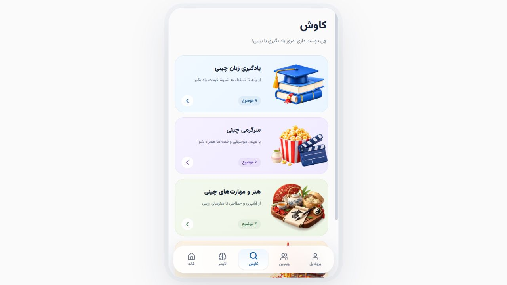
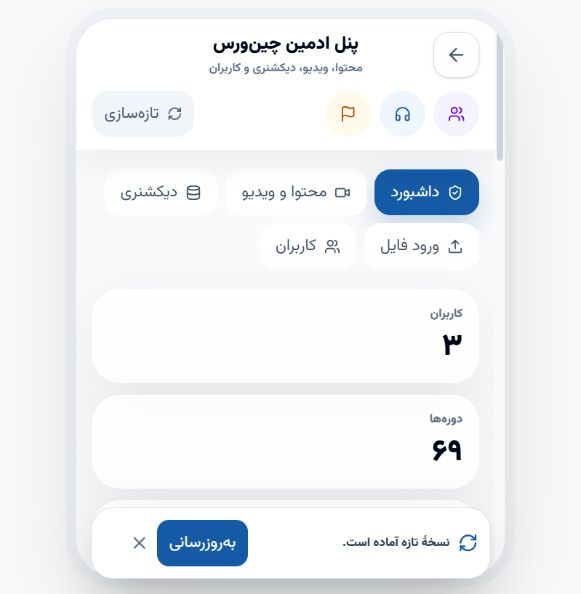

# ثبت وضعیت چین‌ورس — ۲۲ اکتبر ۲۰۲۶

این سند وضعیت فعلی برنامه، بازیابی رایگان و مسیر مدیریت را برای ادامهٔ توسعه ثبت می‌کند. انتشار روی دامنهٔ اصلی، به‌معنی تکمیل تمام پیش‌شرط‌های عرضهٔ عمومی یا تغییر محیط برنامه به production نیست.

## نسخه و تاریخچه

- نسخهٔ آزموده‌شده در پایان بازیابی ۲۱ اکتبر: `94a0da61e601968db3fc0dcb2f57dbb713e6438d`؛ فرانت‌اند و بک‌اند هر دو همین نسخه را گزارش کردند.
- تغییرات توسعه تا این مرحله در شاخهٔ `codex/phase-8-beta-release` ثبت شده‌اند. این checkpoint برای انتقال وضعیت فعلی به `main` از مسیر درخواست ادغام محافظت‌شده آماده شده است.
- دامنهٔ اصلی: [chinverse.vercel.app](https://chinverse.vercel.app).
- محیط فعلی برنامه همچنان `staging` و `indexable=false` است؛ قابلیت‌های پولی از مسیر این checkpoint فعال نمی‌شوند.

## تغییرات قابل استفاده

- کاوش چهار دستهٔ اصلی دارد: یادگیری زبان چینی، سرگرمی، هنر و مهارت، فرهنگ و اندیشه. هر دسته صفحه و رنگ اختصاصی دارد؛ موضوع‌های آماده‌نشده پیام «به‌زودی» دارند.
- تصاویر انتخاب‌شدهٔ مالک در کد برنامه و دارایی‌های runtime ثبت شده‌اند. دکمه‌های بازگشت در سمت راست و عنوان صفحه‌ها در وسط قرار دارند؛ هدرهای مربوطه هنگام اسکرول ثابت می‌مانند.
- اقدامات پایان ویدیو پس از زیرنویس و ادامهٔ دوره قرار دارند و رفت‌وبرگشت پرسش درس به تالار، مسیر همان درس را حفظ می‌کند.
- اصلاحات PWA، نمایش آنلاین، حالت تاریک، پروفایل، خدمات و لایتنر در تاریخچهٔ توسعه موجودند.

## بازیابی رایگان و اطلاعات

علت قطعی ۲۱ اکتبر، تمام‌شدن سهمیهٔ پردازش دیتابیس بود. انتقال پروژه به حساب دیگر مصرف ثبت‌شدهٔ همان پروژه را صفر نکرد. با تأیید مالک، یک پروژهٔ رایگان تازه ساخته شد و بکاپ محلی ۲۹ ژوئیه به آن منتقل و تا آخرین migration ارتقا یافت؛ هیچ خرید یا ارتقای پولی انجام نشد.

- دیتابیس قبلی محفوظ است. داده‌های جدیدترِ قابل‌دسترسی‌نبودن آن، در این بازیابی کامل منتقل نشدند.
- دو حساب قدیمی، یک خدمت، دو پرسش تالار، یک مقاله و دیکشنری ۱۱٬۶۳۰ واژه‌ای بازیابی شدند. پست قابل‌بازیابی در بکاپ قدیمی وجود نداشت.
- ویدیوی اصلی نمونه با شناسهٔ دورهٔ `70` و درس `206`، مدت ۳۴۴٫۵۳۷ ثانیه و ۱۲۰ بخش زیرنویس چینی، پین‌یین و فارسی از fixture فعلی بازسازی شد. دسترسی HLS و checksum زیرنویس بررسی شدند.
- دوره‌ها و درس‌های ساختگیِ قدیمی به‌صورت پیش‌نویس حفظ شدند. منتشرشدن ظاهر کاتالوگ به‌معنی آماده‌بودن تمام درس‌ها نیست.
- حلقهٔ گفت‌وگو در نبود کاربر متصل دیگر SQL polling و maintenance اجرا نمی‌کند؛ شروع اولین اتصال با قفل مشترک و cursor مناسب انجام می‌شود. آزمون ترتیب تحویل رویدادها حفظ شده است.
- پردازش پروژهٔ تازه به ۰٫۲۵ CU محدود و خاموشی پس از ۵ دقیقهٔ بیکاری تأیید شد. خواب واقعی و سپس پاسخ موفق پس از بیداری مشاهده شدند. پلن رایگان همچنان سهمیه دارد.
- اطلاعات محرمانهٔ اتصال در Secretهای سرویس‌ها نگهداری می‌شوند. دیتابیس و بکاپ حساب‌ها بخشی از مخزن عمومی Git نیستند.

## مدیریت

حساب مدیر قبلی در بکاپ قدیمی نبود. مالک با شناسهٔ موردنظر خود دوباره ثبت‌نام کرد؛ نقش همان حساب با ثبت ممیزی امنیتی بازیابی و نشست‌های قبل از ارتقای نقش بسته شدند. مالک شخصاً ورود دومرحله‌ای را فعال کرد؛ ورود موفق با MFA، نشست معتبر و بارگذاری پنل مدیریت روی دامنهٔ اصلی بررسی شدند. از حساب و تنظیمات امنیتی نیز بکاپ تازهٔ محلی تهیه شد.

ایمیل مدیر، شمارهٔ تلفن، رمز، کلید MFA، کدهای بازیابی، توکن‌ها و تصویر پنل سرویس‌های خصوصی در این سند منتشر نمی‌شوند.

## شواهد بررسی

- [Quality gates نسخهٔ بازیابی](https://github.com/MoAminPourzare/Chinverse/actions/runs/39593422006) موفق بود؛ شامل تست‌های بک‌اند، فرانت‌اند، مرورگر و migration.
- [انتشار بک‌اند](https://github.com/MoAminPourzare/Chinverse/actions/runs/39593421990) و [بررسی نسخه و صوت دیکشنری](https://github.com/MoAminPourzare/Chinverse/actions/runs/39593422215) موفق بودند.
- واحدهای بک‌اند: ۳۲۱ تست موفق. ۴۳ تست مرتبط با رسانه و پردازش تصویر با Pillow جدید نیز در محیط محلی موفق بودند.
- در یک اجرای تکراری همان نسخه، تست موقعیت اقدامات پایان درس در mobile WebKit شکست خورد، درحالی‌که اجرای push موفق بود؛ این مورد برای بررسی تکرارپذیری تست باز است و همهٔ اجراها سبز توصیف نمی‌شوند.
- اسموک عملیاتی ثبت‌نام، ورود، پروفایل، محدودماندن بتا برای حساب دعوت‌نشده، HTTP و WebSocket گفت‌وگو، جلوگیری از دسترسی کاربر عادی به مدیریت، پخش درس و دریافت ۱۲۰ cue موفق بود؛ حساب موقت آزمون حذف شد.
- پس از ارتقای دامنهٔ اصلی، سلامت فرانت‌اند و بک‌اند و دریافت درس از proxy اصلی موفق بودند. درخواست داده پس از مشاهدهٔ خواب دیتابیس، HTTP 200 با زمان ثبت‌شدهٔ ۵۶۷ میلی‌ثانیه داشت؛ این یک مشاهده است، نه تضمین زمان پاسخ.
- پس از بازیابی مدیر، حساب دارای نقش admin و MFA فعال بود؛ دو نشست دارای تأیید MFA و پنل شامل داده‌های واقعی مشاهده شدند.

## فایل‌های ثبت‌شده و محلی

کد برنامه، migrationها، fixtureهای قابل‌انتشار، دارایی‌های runtime، lockfileها، آزمون‌ها، اسناد و تمرین‌های مستقل `learning/` در Git نگهداری می‌شوند. تمرین‌ها از dependencyهای قفل‌شدهٔ فرانت‌اند استفاده می‌کنند و بخشی از runtime سایت نیستند.

پوشه‌های `.backups/`، `.tmp/`، `artifacts/`، فایل‌های محیطی خصوصی و اصل تصاویر مرجع مالک محلی می‌مانند. تصاویر مورد استفادهٔ اپ زیر `frontend/public/assets/` ثبت شده‌اند. فقط دو تصویر بازبینی‌شدهٔ فاقد اطلاعات شخصی برای این گزارش کپی شده‌اند.

نسخهٔ کد به‌تنهایی شامل دادهٔ زنده، Secretها یا تنظیمات حساب سرویس‌های میزبانی نیست. در بازیابی بعدی، مقصد دیتابیس، بکاپ معتبر، فضای فایل، migration و سلامت واقعی برنامه باید جداگانه بررسی شوند.
